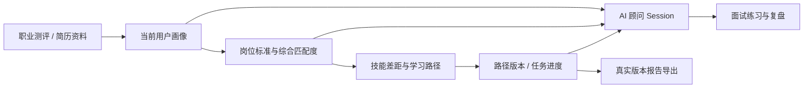

# 智引未来｜AI 职业成长平台

> 面向学生与职业转型者的职业规划 Web 应用：从测评与画像出发，用可解释的岗位匹配找到差距，再把目标转化为可保存、可追踪的学习路径，并通过 AI 顾问和模拟面试持续复盘。


## 项目概览

本项目由 React 前端与 FastAPI 后端组成。用户注册登录后，可以完成职业测评、生成个人画像、查看岗位标准匹配结果、生成和回看学习路径、与带有当前画像和路径上下文的 AI 顾问对话、进行面试练习，并导出所选路径版本的 Markdown 报告。

项目把**可验证的计算**和**生成式 AI**分开：综合匹配度由用户实际填写的技能与数据库岗位标准计算；模型负责画像信息提取、差距解释、学习建议与对话，不负责凭空编造匹配百分比。当前仓库提供明确标注的演示岗位标准，方便从零运行；它们不是实时招聘数据，也不能用来预测录用概率。



## 核心功能

| 模块 | 当前实现 |
| --- | --- |
| 账号与画像 | JWT 登录、用户隔离；测评与简历资料写入当前用户画像，区分兴趣、软技能、目标岗位和每周学习时间。 |
| 岗位推荐 | 基于数据库岗位标准计算综合匹配度，展示已匹配项和待补齐项；缺少必要证据时不显示百分比。 |
| 学习路径 | 结合画像、岗位要求和学习时间生成阶段计划；成功生成后保存版本、当时的画像/匹配快照及任务进度。 |
| AI 顾问 | 从当前用户画像、目标岗位、技能差距和选中路径读取有界上下文；支持新建、继续、清空独立 Session。 |
| 面试训练 | 生成通用或定向题目，评估回答并保存历史；历史薄弱点用于后续定向练习。 |
| 报告导出 | 按当前用户选中的路径版本导出 Markdown，包含已保存的内容与最新任务进度。 |
| 语音辅助 | WAV 语音识别与异步语音合成；TTS 提供生成中、成功、失败、过期状态及授权播放链接。 |
| 数据展示 | 成长中心、岗位样本、能力图表与职业关系图；没有外部岗位数据时展示空状态。 |

### 综合匹配度如何计算

推荐与差距分析共用同一评分函数。默认权重为**核心技能 80% + 软素质 15% + 目标/兴趣 5%**；某类岗位要求缺失时，对剩余权重重新归一化。页面同时展示匹配和缺失的要求，便于解释分数来源。岗位缺少核心技能标准，或用户未提供任何能力证据时，分数为 `null`，不会按照列表顺序或默认值生成百分比。这个分数表示**已填写画像对当前岗位标准的覆盖程度**，不是招聘录用概率。

### AI 调用与数据边界

- 模型调用设置超时、有限重试和可选备用文本模型；超时、连接失败、限流等错误会分类返回，失败的结构化结果不会保存为正常记录。
- 顾问只读取当前用户、当前 Session 的近期消息，并控制画像、岗位与路径上下文长度；清空 Session 后旧消息不会继续进入新对话。
- 学习路径和面试评估支持 `Idempotency-Key`，聊天支持 `request_id`，用于避免客户端重试导致重复保存。
- 路径历史读取数据库中的既有版本，不重新调用模型。导出按版本和用户权限读取真实记录。
- SQLite 数据、`.env` 密钥、生成的语音文件及本地依赖均不提交到仓库。

## 技术栈与目录

| 层次 | 技术 |
| --- | --- |
| 前端 | React 18、TypeScript、Vite 5、Ant Design、ECharts、Zustand、Axios |
| 后端 | FastAPI、Pydantic、SQLAlchemy、SQLite |
| AI | 智谱 AI SDK；文本、语音识别和语音合成模型可通过环境变量配置 |
| 验证 | Node 内置测试、ESLint、TypeScript、Python `unittest`、生产构建 |

```text
career-planning-agent/
├─ frontend/                  # 前端源码、样式、测试与构建配置
│  ├─ public/brand-mark.png   # 产品 Logo
│  ├─ src/                    # 页面、组件、API 客户端与状态管理
│  └─ tests/                  # 前端逻辑测试
├─ core/                      # 数据库、鉴权与统一匹配算法
├─ models/                    # ORM 与请求/响应模型
├─ scripts/                   # 演示标准初始化、可选岗位导入与图谱生成
├─ data/
│  └─ demo_job_standards.json # 明确标注的演示岗位标准
├─ tests/                     # 后端 API 与完整业务链路测试
├─ docs/screenshots/          # 可公开展示的页面截图
├─ main.py                    # FastAPI 应用与业务接口
├─ requirements.txt
└─ .env.example
```

后端保留仓库原有的根目录布局；前端集中放在 `frontend/`，避免把 `node_modules`、构建产物或本地数据库放进版本控制。

## 本地运行

以下命令在**仓库根目录**执行；当前验证环境为 Python 3.13、Node.js 24。前端 lint 工具要求 Node.js `^20.19.0 || ^22.13.0 || >=24`；Python 依赖版本固定在 `requirements.txt`，前端使用 `package-lock.json`。

### 1. 启动后端

```powershell
python -m venv .venv
.\.venv\Scripts\Activate.ps1
python -m pip install -r requirements.txt
Copy-Item .env.example .env
```

macOS / Linux 可将激活与复制命令分别换成 `source .venv/bin/activate`、`cp .env.example .env`。编辑 `.env`，填写自己的 `ZHIPUAI_API_KEY` 和至少 32 字符的 `JWT_SECRET_KEY`。可用下面的命令生成后者：

```powershell
python -c "import secrets; print(secrets.token_urlsafe(48))"
```

全新安装建议先加入演示岗位标准；脚本只补充缺失的标准，不覆盖已有标准，也**不会写入虚构招聘岗位**：

```powershell
python scripts/seed_demo_data.py
uvicorn main:app --host 127.0.0.1 --port 8000 --reload
```

后端接口文档：`http://127.0.0.1:8000/docs`。首次启动会创建本地 SQLite 表，包括空的 `jobs` 表；没有岗位样本时，岗位列表与统计接口返回空数据，不会报错。

### 2. 启动前端

在另一个终端中执行：

```powershell
cd frontend
npm ci
npm run dev
```

打开 `http://127.0.0.1:5173`。开发服务器默认将 `/api` 和 `/static` 代理到 `http://localhost:8000`。如果后端地址不同，可参考 `frontend/.env.example` 配置 `VITE_API_PROXY_TARGET`；正式静态部署时需设置前端 API 地址，并在 `main.py` 的 CORS 白名单中加入前端域名。

### 3. 体验建议

注册账号后，依次进入 **职业测评 → 成长中心画像 → 岗位推荐 → 学习路径 → AI 顾问 → 面试训练**。选择一个目标岗位并生成路径后，可以完成任务、回看历史版本，再导出该版本的报告。调用模型需要有效的服务商 API Key；模型请求可能产生费用。

仓库不包含真实招聘数据。若你拥有自己的 `data/jobs-data.xls`，可查看 `scripts/init_db.py` 的列映射后按需导入；该脚本会**替换**本地数据库的 `jobs` 表，运行前请备份已有岗位样本。岗位标准与招聘岗位是两类数据：前者决定匹配度，后者只用于岗位列表及统计。

## 测试与验收

```powershell
# 仓库根目录，已激活 Python 虚拟环境
python -m unittest discover -s tests -v
python -m compileall -q main.py core models scripts tests

# frontend/ 目录
npm test
npm run lint
npm run build
```

后端测试使用隔离的临时 SQLite 与可控模型响应，覆盖鉴权、用户隔离、推荐评分、路径版本、导出、聊天 Session、幂等和语音状态；其中包含从测评到顾问的连贯业务链路。真实模型连通性及顾问 API 已在**合成数据 + 临时数据库**中单独验证，不会触碰生产用户资料。生产构建使用路由懒加载与依赖分块；图表依赖在需要的页面加载。

## 已知边界

- 演示岗位标准为手工整理的示例，不是实时职位数据；实际推荐质量取决于所维护的岗位标准和用户画像质量。
- 当前以 SQLite 和单进程内存限流支持本地及单实例演示。多实例部署需将限流状态移到共享存储，同时保留数据库唯一索引作为幂等保障。
- 模型生成的建议需要用户判断和复核；本项目没有引入向量数据库、复杂 Agent 编排或 Streaming。
- 后端依赖仍会输出少量 FastAPI / Pydantic 旧 API 的弃用警告，当前测试与启动不受影响。

## 简历项目描述参考

**智引未来｜AI 职业成长平台（React + TypeScript + FastAPI + SQLite + 智谱 AI）**

- 设计“测评—画像—推荐—学习路径—顾问—面试—导出”闭环，将岗位综合匹配度从模型猜测改为基于技能、软素质和目标偏好的可解释计算，并统一多个入口的评分依据。
- 实现带快照和进度的学习路径版本、用户隔离的聊天 Session、受控 AI 上下文及请求幂等，使历史回看与导出能够复现用户当时选择的真实结果。
- 补齐 AI 超时/重试/错误分类、异步语音状态及前后端自动化验证；通过路由懒加载和依赖分块控制单个构建文件体积。

以上描述基于当前仓库功能，未包含未经验证的用户规模、准确率或性能提升百分比。
