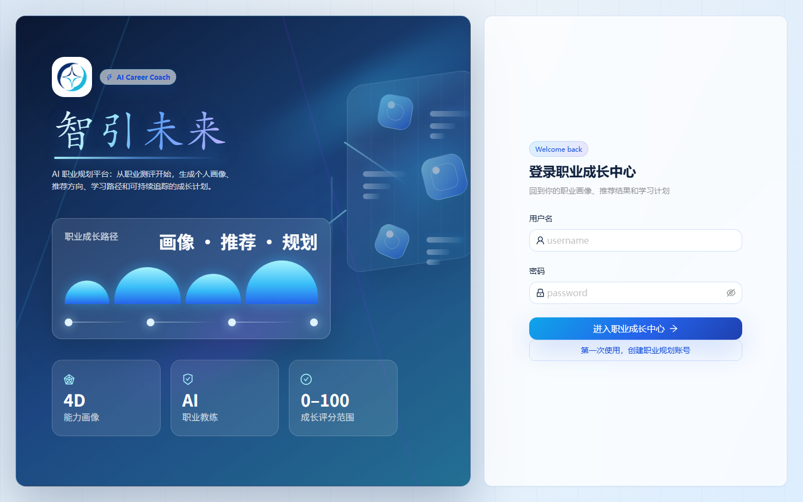

# 智引未来｜AI 职业成长平台

> 面向中国大陆学生的职业规划 Web 应用：按目标岗位核对已填报能力，把差距转化为可保存、可追踪的学习路径，再通过 AI 顾问和面试练习复盘。目前提供技术岗位运行示例，以及市场与内容、人力资源两个领域的六个入门角色试点。



## 项目概览

本项目由 React 前端与 FastAPI 后端组成。用户注册登录后，可以完成职业测评、生成个人画像、查看岗位标准匹配结果、生成和回看学习路径、与带有当前画像和路径上下文的 AI 顾问对话、进行面试练习，并导出所选路径版本的 Markdown 报告。

项目把**规则计算**和**生成式 AI**分开：标准覆盖参考由用户填报的能力、偏好与数据库标准计算；模型负责信息提取、差距解释、学习建议与对话。职业标准的来源、版本及限制随结果展示；学习路径保存生成时的画像、匹配和来源快照。这些资料不是实时招聘数据，计算结果不能预测录用概率。

| 公开资料 | 当前范围与含义 |
| --- | --- |
| 技术岗位运行示例 | 四个明确标注的手工示例，帮助从零运行；不是由招聘样本统计得到的标准。 |
| 市场与内容试点 | 市场助理、内容运营、新媒体运营。 |
| 人力资源试点 | 招聘助理、人事助理、培训助理。 |

六个试点依据教育部职业教育教学标准及部分雇主任务页面独立归纳。`source_checked` 表示来源正文已核对，**不表示岗位从业者审核、全国雇主代表性或推荐效果验证**；人事助理仍主要依据教学标准，培训助理增加了 HRBP 实习职责中的培训支持例证。详见[数据来源与限制](docs/data-sources.md)。


## 核心功能

| 模块 | 当前实现 |
| --- | --- |
| 账号与画像 | JWT 登录、用户隔离；测评与简历资料写入当前用户画像，区分兴趣、软技能、目标岗位和每周学习时间。 |
| 岗位目录与比较 | 目录列出实际导入的角色，按领域浏览；展示来源、版本、限制及匹配/缺失能力，支持部分明确技能别名。 |
| 学习路径 | 结合画像、目标任务和学习时间生成计划；非 IT 试点校验动作、产出、自查和耗时，限制最多四周及时间预算；保存版本、画像/匹配/来源快照和进度。 |
| AI 顾问 | 从当前用户画像、目标岗位、技能差距和选中路径读取有界上下文；支持新建、继续、清空独立 Session。 |
| 面试训练 | 生成通用或定向题目，评估回答并保存历史；历史薄弱点用于后续定向练习。 |
| 报告导出 | 按当前用户选中的路径版本导出 Markdown，包含已保存的内容与最新任务进度。 |
| 语音辅助 | WAV 语音识别与异步语音合成；TTS 提供生成中、成功、失败、过期状态及授权播放链接。 |
| 数据展示 | 成长中心、岗位样本、能力图表与职业关系图；没有外部岗位数据时展示空状态。 |

### 标准覆盖参考如何计算

推荐与差距分析共用同一评分函数：**核心技能覆盖 80% + 软素质覆盖 15% + 目标/兴趣相关 5%**。缺少软素质要求时，对剩余权重重新归一化。因此它是包含偏好的加权参考，技能覆盖率另行展示。名称按大小写、空白及明确别名归一；“计划学习”“不掌握”和宽泛工具名称不自动证明掌握具体任务。

岗位缺少核心能力标准，或用户未填报有效硬/软能力时，结果为 `null`。来源未分类的旧标准以及修改后尚未重新核对的标准也不给当前百分比。不同职业的能力粒度、范围和学习成本不同，**分数不是跨领域统一适合度，也不是就业能力测量或录用概率**；建议先选领域和目标，查看具体差距。

| 来源状态 | 当前处理 |
| --- | --- |
| `manual_pilot` / `source_checked` | 人工归纳的试点，显示可核对来源及限制；可以计算规则覆盖参考。 |
| `demo_example` | 公开运行示例，明确提示未经真实招聘要求验证。 |
| `legacy_unverified` | 既有标准形成过程未追溯；已知技术角色保留参考计算并提示未核实，陌生角色归 `unclassified` 并不给分。 |
| `modified_unverified` | 内容已偏离来源核对时的指纹；保留原来源说明，停止当前评分及新路径生成。历史版本继续使用原快照。 |

完全没有标准或只有未分类旧标准的目标，仍可生成明确标注的探索路径；这不能证明该目标的能力差距已经验证。

### AI 调用与数据边界

- 模型调用设置超时、有限重试和可选备用文本模型；超时、连接失败、限流等错误分类返回。画像、学习路径、面试评估及模拟面试题组有结构校验；这只保护格式和流程，不能证明内容正确。
- 顾问只读取当前用户、当前 Session 的近期消息，并控制画像、岗位与路径上下文长度；清空 Session 后旧消息不会继续进入新对话。
- 学习路径和面试评估支持 `Idempotency-Key`，聊天支持 `request_id`，用于避免客户端重试导致重复保存。
- 路径历史读取数据库中的既有版本，不重新调用模型。导出按版本和用户权限读取记录；旧路径未保存来源时明确标注缺失，不用当前目录替代历史依据。
- 非 IT 试点只保留已核对来源的资源链接；未核实认证任务、缺少任务字段或超过时间预算的结果不保存。模型的资源字符串与链接对象先归一再验证；这些规则仍不能证明建议正确或任务估时准确。
- 用户填报能力是自述信息；模型产生的四维分析分数和面试评分属于模型解释，未经外部能力测评。建议、任务、资格及资源需结合具体岗位复核。
- SQLite 数据、`.env` 密钥、生成的语音文件及本地依赖均不提交到仓库。

## 技术栈与目录

| 层次 | 技术 |
| --- | --- |
| 前端 | React 18、TypeScript、Vite 5、Ant Design、ECharts、Zustand、Axios |
| 后端 | FastAPI、Pydantic、SQLAlchemy、SQLite |
| AI | 智谱 AI SDK；文本、语音识别和语音合成模型可通过环境变量配置 |
| 验证 | Node 内置测试、ESLint、TypeScript、Python `unittest`、生产构建 |

```text
career-planning-agent/
├─ frontend/                  # 前端源码、样式、测试与构建配置
│  ├─ public/brand-mark.png   # 产品 Logo
│  ├─ src/                    # 页面、组件、API 客户端与状态管理
│  └─ tests/                  # 前端逻辑测试
├─ core/                      # 数据库、鉴权、匹配算法与标准来源校验
├─ models/                    # ORM 与请求/响应模型
├─ scripts/                   # 示例/试点导入、可选岗位导入与旧图谱生成
├─ data/
│  ├─ demo_job_standards.json  # 四个技术运行示例
│  └─ pilot_job_standards.json # 六个试点、任务/来源/限制及技能词典
├─ tests/                     # 后端规则、数据完整性与 HTTP 业务流程测试
├─ docs/                      # 来源、取舍、验证记录及演示说明
├─ .github/workflows/ci.yml   # 后端检查与前端测试/lint/构建配置
├─ main.py                    # FastAPI 应用与业务接口
├─ requirements.txt
└─ .env.example
```

后端保留仓库原有的根目录布局；前端集中放在 `frontend/`，避免把 `node_modules`、构建产物或本地数据库放进版本控制。

## 本地运行

以下命令在**仓库根目录**执行；当前验证环境为 Python 3.13、Node.js 24。前端 lint 工具要求 Node.js `^20.19.0 || ^22.13.0 || >=24`；Python 依赖版本固定在 `requirements.txt`，前端使用 `package-lock.json`。

### 1. 启动后端

```powershell
python -m venv .venv
.\.venv\Scripts\Activate.ps1
python -m pip install -r requirements.txt
Copy-Item .env.example .env
```

macOS / Linux 可将激活与复制命令分别换成 `source .venv/bin/activate`、`cp .env.example .env`。编辑 `.env`，填写自己的 `ZHIPUAI_API_KEY` 和至少 32 字符的 `JWT_SECRET_KEY`。可用下面的命令生成后者：

```powershell
python -c "import secrets; print(secrets.token_urlsafe(48))"
```

建议先选择独立的演示数据库，再导入六个非 IT 试点。`CAREER_DATABASE_PATH` 未设置时仍使用 `data/career_project.db`；相对路径以仓库根目录为基准。下面的 PowerShell 环境变量仅作用于当前终端，导入和启动应在同一终端执行：

```powershell
$env:CAREER_DATABASE_PATH = "data/portfolio-demo.db"
python scripts/seed_pilot_standards.py
# 可选：同时体验四个技术运行示例
python scripts/seed_demo_data.py
uvicorn main:app --host 127.0.0.1 --port 8000 --reload
```

macOS / Linux 使用 `export CAREER_DATABASE_PATH=data/portfolio-demo.db`，也可将路径填写到 `.env`。种子脚本先校验数据包，只补缺失岗位，不覆盖同名标准或来源记录，**不会写入招聘岗位**。修改包内同名角色后重复导入不会升级已有记录，当前未提供自动版本迁移。

后端接口文档：`http://127.0.0.1:8000/docs`。首次启动会创建本地 SQLite 表，包括空的 `jobs` 表；没有岗位样本时，岗位列表与统计接口返回空数据，不会报错。

### 2. 启动前端

在另一个终端中执行：

```powershell
cd frontend
npm ci
npm run dev
```

打开 `http://127.0.0.1:5173`。开发服务器默认将 `/api` 和 `/static` 代理到 `http://localhost:8000`。如果后端地址不同，可参考 `frontend/.env.example` 配置 `VITE_API_PROXY_TARGET`；正式静态部署时需设置前端 API 地址，并在 `main.py` 的 CORS 白名单中加入前端域名。

### 3. 体验建议

注册账号后，在职业测评选择“市场与内容”或“人力资源”、目标角色和已掌握能力，再依次查看 **画像 → 标准覆盖与来源 → 能力差距 → 学习路径 → AI 顾问**。完成一项路径任务、重新打开保存版本，再导出该版本的报告。面试练习可作为后续复盘。演示操作见[核心流程说明](docs/demo-walkthrough.md)，各项实际运行结果见[验证记录](docs/validation.md)。调用模型需要有效的服务商 API Key，可能产生费用。

仓库不包含企业招聘原始数据。可选 `scripts/init_db.py` 使用原有固定 Excel/数据库路径，会**替换**其指向的 `jobs` 表；它未接入上述隔离路径配置，运行前必须核对脚本路径和列映射并备份。岗位标准决定覆盖参考，岗位样本用于浏览和统计；增加招聘记录不会自动生成新标准。旧 `build_graph.py` 仍是按固定技术岗位调用模型的可选生成脚本，不是本轮试点来源，也没有复现“企业招聘语料→统计标准”的管线。

## 测试与验收

```powershell
# 仓库根目录，已激活 Python 虚拟环境
python -m unittest discover -s tests -v
python -m compileall -q main.py core models scripts tests

# frontend/ 目录
npm test
npm run lint
npm run build
```

| 验证层次 | 能确认什么及限制 |
| --- | --- |
| 规则与导入回归 | 技能归一、相邻能力不误认、包校验、重复导入、同名旧数据不虚标、标准修改后来源状态失效。 |
| HTTP + 隔离 SQLite + 可控模型 | 市场和人力资源的问卷—差距—路径—进度—恢复—顾问—导出链路；历史来源、权限、会话绑定、失败不落库及重试。能验证集成数据流，不能评价模型建议质量。 |
| 前端逻辑、lint 和构建 | 验证目录筛选、输入处理及部分业务辅助函数，检查类型和构建；不会替代实际浏览器操作。 |
| 真实 AI 与浏览器 | 必须单独实际执行并记录；本轮状态只以[验证记录](docs/validation.md)为准，截图和可控模型响应不等于真实模型贯通。 |

[CI 配置](.github/workflows/ci.yml)执行后端测试/编译检查和前端测试/lint/构建；实际远程结果见 [GitHub Actions](https://github.com/Richard-Lee0419/career-planning-agent/actions/workflows/ci.yml)。当前构建使用路由懒加载与依赖分块，尚未提供用户端性能提升测量。

2026-10-12最终本地验收：干净环境中67项后端、8项前端检查通过，lint、生产构建与依赖一致性检查通过；六个非IT合成画像分两批完成真实模型/API流程。浏览器确认图表、同域比较、来源、历史恢复、进度和原生报告下载。入门路径只选两项能力，顾问参考所选版本的下一项待办；不合格输出最多修正一次，仍不合格就不保存。完整结果、真实失败及建议内容评审见[演示证据](docs/demo/README.md)和[验证记录](docs/validation.md)；这些结果没有证明建议准确率或就业收益。

## 已知边界

- 本轮增加职业标准范围，没有增加中国大陆多行业招聘语料，未实现全专业映射、岗位需求频率或薪资统计；六个试点不代表完整覆盖这两个就业领域。
- 来源核对、规则测试通过和模型连通都不证明推荐准确率、建议有效性或就业收益；专业与职业不能按本轮教学资料作固定一对一映射。
- 当前以 SQLite 和单进程内存限流支持本地及单实例演示。多实例部署需将限流状态移到共享存储，同时保留数据库唯一索引作为幂等保障。
- 模型生成的建议需要用户判断和复核；本项目没有引入向量数据库、复杂 Agent 编排或 Streaming。
- 后端依赖仍会输出少量 FastAPI / Pydantic 旧 API 的弃用警告，当前测试与启动不受影响。

当前实现的关键选择、替代方案和适用边界见[设计取舍](docs/design-decisions.md)。

## 简历项目描述参考

**智引未来｜AI 职业成长平台（React + TypeScript + FastAPI + SQLite + 智谱 AI）**

- 实现 React + FastAPI 职业规划流程，按技能、软素质和目标偏好计算可解释的岗位标准覆盖参考，并统一推荐、差距和报告的依据。
- 扩展市场与内容、人力资源六个入门角色试点，维护来源版本、技能别名及内容指纹；区分示例、未追溯标准和修改后待核对内容。
- 实现路径快照、任务进度、用户隔离的顾问会话和版本报告导出；以隔离 SQLite 与可控 AI 响应验证跨领域流程、异常路径和历史证据保留。

以上描述基于当前仓库功能，未包含未经验证的用户规模、准确率或性能提升百分比。
